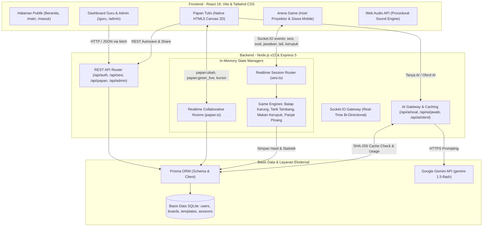
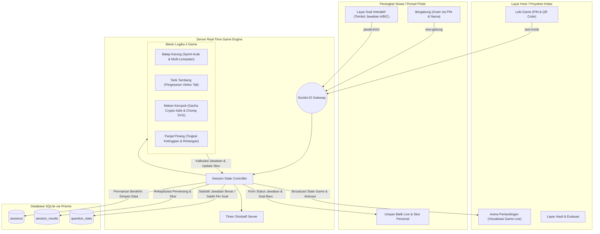
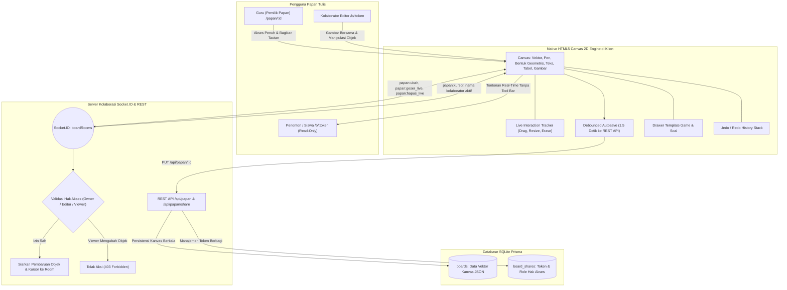

# Discere

**Platform Pembelajaran Interaktif: Papan Tulis Digital dan Game Edukasi Berbasis Web**

Dikembangkan untuk **LOGICODIX 2026 Hackathon Competition** dengan subtema **Smart & Fun Education**.

**Tagline:** *Belajar Serius, Bermain Gembira!*

---

## Informasi Proyek

| Informasi | Keterangan |
|---|---|
| Nama Proyek | Discere |
| Nama Tim | Timber |
| Institusi | SMKN 13 Bandung |
| Kategori | Web Application |
| Subtema | Smart & Fun Education |
| Tahun | 2026 |

## Tentang Discere

Discere merupakan platform pembelajaran interaktif yang menggabungkan papan tulis digital dan permainan edukatif dalam satu aplikasi berbasis web.

Platform ini dirancang untuk membantu guru menyampaikan materi dan melakukan evaluasi pembelajaran dengan cara yang lebih menarik.

Melalui Discere, guru dapat membuat materi menggunakan papan tulis digital, menyusun soal dengan bantuan AI, serta menjalankan berbagai permainan edukatif bertema perlombaan tradisional 17 Agustus.

Siswa dapat mengikuti permainan melalui satu layar proyektor maupun perangkat masing-masing tanpa harus membuat akun.

## Latar Belakang dan Permasalahan

### Permasalahan

1. **Kejenuhan dalam Pembelajaran**

   Evaluasi pembelajaran sering kali masih menggunakan soal pilihan ganda konvensional sehingga kurang memberikan pengalaman belajar yang interaktif.

2. **Fragmentasi Media Pembelajaran**

   Guru membutuhkan beberapa platform berbeda untuk menyampaikan materi, menggunakan papan tulis digital, dan menjalankan kuis.

3. **Hambatan Akses Siswa**

   Sebagian platform pembelajaran mengharuskan siswa melakukan registrasi atau mengunduh aplikasi sebelum dapat mengikuti kegiatan.

### Solusi yang Ditawarkan

Discere menghadirkan platform terpadu yang menyediakan:

- Papan tulis digital untuk membantu guru menyampaikan materi.
- Berbagai game edukasi sebagai media evaluasi pembelajaran.
- Mode Solo dan Multiplayer sesuai kebutuhan kegiatan belajar.
- Akses siswa menggunakan PIN atau QR Code tanpa registrasi akun.
- Fitur AI untuk membantu pembuatan soal dan penjelasan materi.

## Target Pengguna

**Guru / Tenaga Pendidik**

Guru SD, SMP, SMA, dan SMK yang membutuhkan media pembelajaran interaktif, alat bantu penyampaian materi, serta evaluasi pembelajaran yang lebih menarik.

**Siswa / Peserta Didik**

Siswa yang ingin mengikuti kegiatan pembelajaran dan evaluasi melalui permainan edukatif menggunakan perangkat komputer maupun ponsel.

---

## Fitur Utama

### 1. Papan Tulis Digital Interaktif

Discere menyediakan papan tulis digital dengan kanvas luas yang dapat digunakan guru untuk menyampaikan materi secara visual.

Fitur yang tersedia:

- Menggambar dan menulis menggunakan berbagai jenis pena.
- Membuat berbagai bentuk geometris.
- Menambahkan teks, tabel, dan gambar.
- Menggeser serta memperbesar dan memperkecil kanvas.
- Undo dan Redo.
- Autosave secara otomatis.
- Mode presentasi dan layar penuh.
- Ekspor hasil papan ke format PNG dan JSON.
- Kolaborasi beberapa pengguna secara real-time.
- Pembagian akses Editor dan Viewer melalui tautan.

### 2. Game Edukasi Bertema 17 Agustus

Discere menghadirkan berbagai permainan yang terinspirasi dari perlombaan tradisional Indonesia.

Permainan ini menggabungkan soal pembelajaran dengan mekanisme kompetisi sehingga siswa dapat belajar sambil bermain.

**Pilihan permainan:**

- **Balap Karung:** Permainan edukatif yang mengadaptasi perlombaan balap karung.
- **Tarik Tambang:** Permainan kompetisi dua tim yang menggunakan jawaban benar untuk menggerakkan tali menuju kemenangan.
- **Makan Kerupuk:** Permainan individu dengan mekanisme menjawab soal dan mendapatkan kesempatan menggigit kerupuk virtual.
- **Panjat Pinang:** Permainan edukatif yang mengadaptasi perlombaan panjat pinang.

### 3. Mode Solo dan Multiplayer

Setiap permainan menyediakan pilihan mode sesuai kebutuhan pembelajaran.

**Mode Solo**

Permainan dijalankan melalui satu layar komputer atau proyektor yang digunakan bersama di dalam kelas. Guru mengatur jalannya permainan dan siswa berpartisipasi melalui layar tersebut.

**Mode Multiplayer**

Siswa dapat mengikuti permainan menggunakan perangkat masing-masing.

Cara bergabung:

1. Guru memulai permainan melalui dashboard.
2. Sistem menampilkan kode PIN dan QR Code.
3. Siswa membuka halaman bergabung.
4. Siswa memasukkan PIN dan nama panggilan.
5. Siswa mengikuti permainan secara langsung.

Komunikasi permainan menggunakan Socket.IO untuk menyinkronkan aktivitas peserta secara real-time.

### 4. Generator Soal AI

Guru dapat membuat soal pilihan ganda secara otomatis berdasarkan materi pembelajaran.

Fitur ini memungkinkan guru untuk:

- Memasukkan teks materi.
- Menentukan jumlah soal.
- Memilih jenjang pendidikan.
- Menghasilkan soal menggunakan AI.
- Meninjau dan mengedit hasil sebelum disimpan.

### 5. Asisten AI Papan Tulis

Guru dapat menggunakan bantuan AI langsung melalui papan tulis digital.

Fitur yang tersedia:

- Tanya AI berdasarkan area soal yang dipilih.
- Mendapatkan jawaban dan penjelasan.
- Mendapatkan rumus serta langkah penyelesaian.
- Obrolan AI mengenai materi pembelajaran.
- Melampirkan gambar, dokumen, dan berkas pendukung.

### 6. Dashboard Guru

Dashboard guru menyediakan pengelolaan kegiatan pembelajaran dalam satu tempat.

Fitur yang tersedia:

- Ringkasan aktivitas.
- Pembuatan dan pengelolaan template soal.
- Pustaka template resmi.
- Pengelolaan sesi permainan.
- Pengelolaan papan tulis.
- Riwayat permainan.
- Hasil dan evaluasi jawaban siswa.

### 7. Dashboard Administrator

Dashboard administrator digunakan untuk mengelola platform.

Fitur yang tersedia:

- Statistik penggunaan platform.
- Pengelolaan akun guru.
- Aktivasi dan nonaktivasi akun.
- Pengelolaan pustaka template resmi.
- Monitoring penggunaan AI.
- Audit trail aktivitas administrator.

Administrator tidak memiliki akses untuk melihat konten privat papan tulis dan template milik guru.

---

## Teknologi yang Digunakan

| Kategori | Teknologi | Kegunaan |
|---|---|---|
| Frontend | React 18 | Membangun antarmuka aplikasi |
| Build Tool | Vite | Menjalankan dan membangun frontend |
| Styling | Tailwind CSS | Mengatur tampilan aplikasi |
| Icons | Lucide React | Ikon antarmuka |
| Backend | Node.js | Lingkungan eksekusi server |
| Backend Framework | Express.js | REST API |
| Real-time | Socket.IO | Komunikasi real-time |
| Database | SQLite | Penyimpanan data |
| ORM | Prisma ORM | Pengelolaan database |
| Validation | Zod | Validasi data |
| Authentication | JWT | Autentikasi pengguna |
| Password Hashing | bcryptjs | Pengamanan kata sandi |
| AI | Google Gemini API | Generator soal dan asisten AI |
| Audio | Web Audio API | Efek suara permainan |

---

## Struktur Tim

**Nama Tim: Timber**

**Institusi: SMKN 13 Bandung**

### Refky ([@refkyaja](https://github.com/refkyaja))

Bertanggung jawab mengerjakan landing page dan fitur papan tulis digital (Canvas), serta membantu desain antarmuka dashboard admin dan guru.

### Kaka ([@Kalzz76](https://github.com/Kalzz76))

Bertanggung jawab mengerjakan tampilan dashboard admin dan guru, mengembangkan logika serta alur sistem pada kedua dashboard, dan mendesain halaman game.

### Alip ([@lemonade199](https://github.com/lemonade199))

Bertanggung jawab mengerjakan desain dan logika permainan, serta mengurus kebutuhan administrasi tim.

---

## Cara Menjalankan Aplikasi

### 1. Persyaratan Sistem

Pastikan perangkat sudah memiliki:

- Node.js v22 atau versi LTS yang kompatibel.
- npm.
- Git.

### 2. Clone Repository

```bash
git clone https://github.com/refkyaja/DIscere.git
```

Masuk ke direktori proyek:

```bash
cd DIscere
```

### 3. Instalasi Dependensi

```bash
npm install
```

### 4. Konfigurasi Environment

Salin file `.env.example` menjadi `.env`.

```bash
cp .env.example .env
```

Pada Windows Command Prompt, dapat menggunakan:

```cmd
copy .env.example .env
```

Sesuaikan konfigurasi berikut dengan kebutuhan aplikasi:

| Variabel | Keterangan |
|---|---|
| PORT | Port server backend |
| DATABASE_URL | Lokasi database SQLite |
| JWT_SECRET | Kunci autentikasi JWT |
| AI_API_KEY | API Key layanan AI |
| AI_MODEL | Model AI yang digunakan |
| AI_BATAS_HARIAN | Batas penggunaan AI harian |
| AI_BATAS_OBROL | Batas penggunaan obrolan AI harian |

**Catatan:** Jangan membagikan API Key atau kredensial pribadi melalui repository publik.

### 5. Migrasi Database

Jalankan perintah berikut untuk menyiapkan database:

```bash
npm run db:migrate
```

### 6. Mengisi Data Awal

Jalankan perintah berikut untuk membuat data awal aplikasi:

```bash
npm run db:seed
```

### 7. Menjalankan Mode Pengembangan

```bash
npm run dev
```

Aplikasi dapat diakses melalui:

- Frontend: `http://localhost:5173`
- Backend API: `http://localhost:3000`

### 8. Menjalankan Mode Produksi

Build aplikasi:

```bash
npm run build
```

Jalankan server:

```bash
npm start
```

Aplikasi dapat diakses melalui:

`http://localhost:3000`

### 9. Akun Demonstrasi (Pengujian Juri)

Untuk memudahkan evaluasi oleh dewan juri, data awal (`seed`) telah menyediakan akun demonstrasi berikut:

| Peran Akun | Email Login | Kata Sandi | Keterangan |
|---|---|---|---|
| **Administrator** | `admin@discere.local` | `AdminDiscere2026!` | Pengawasan platform, manajemen guru, & audit trail |
| **Guru Demo** | `guru@discere.local` | `GuruDiscere2026!` | Dilengkapi template kuis siap main |

---

## Pengujian Otomatis

Discere menyediakan pengujian otomatis untuk memeriksa fungsi utama aplikasi.

Jalankan pengujian logika permainan:

```bash
npm --prefix server test
```

---

## Diagram Arsitektur Sistem dan Alur Data

### 1. Diagram Arsitektur Sistem Global



### 2. Diagram Alur Game Edukasi (Solo & Multiplayer)



### 3. Diagram Alur Papan Tulis Kolaboratif & Sinkronisasi Real-Time



---

## Penggunaan Artificial Intelligence

Penggunaan AI dalam Discere dibagi menjadi dua bagian.

### 1. AI sebagai Alat Bantu Pengembangan

Tim menggunakan AI Coding Assistant sebagai alat bantu selama proses pengembangan aplikasi.

AI dimanfaatkan untuk membantu:

- Eksplorasi dan penyusunan struktur kode.
- Pengembangan logika fitur.
- Implementasi komponen antarmuka.
- Penyusunan pengujian otomatis.
- Pemeriksaan dan perbaikan kode.

Seluruh hasil pengembangan tetap ditinjau, diuji, dan menjadi tanggung jawab tim.

### 2. AI sebagai Fitur Aplikasi

Discere menggunakan Google Gemini API untuk mendukung beberapa fitur utama.

**Generator Soal AI**

Membantu guru menghasilkan soal pilihan ganda berdasarkan materi pembelajaran yang dimasukkan.

**Tanya AI**

Menganalisis area soal atau materi pada papan tulis dan memberikan jawaban beserta langkah penyelesaian.

**Obrolan Asisten AI**

Membantu guru mendapatkan informasi dan penjelasan tambahan seputar materi pembelajaran.

Hasil yang dihasilkan AI tetap perlu diperiksa oleh guru sebelum digunakan dalam kegiatan pembelajaran.

### 3. Pengelolaan Penggunaan AI

Discere menerapkan beberapa mekanisme untuk mengelola penggunaan AI:

- Validasi hasil AI menggunakan Zod.
- Penyimpanan cache menggunakan SHA-256.
- Pembatasan penggunaan AI harian.
- API Key dikelola melalui backend.
- Guru diingatkan untuk tidak memasukkan data pribadi siswa ke dalam prompt.

---

## Privasi dan Keamanan

Discere menerapkan beberapa mekanisme untuk menjaga keamanan dan privasi pengguna.

- Siswa dapat mengikuti permainan tanpa membuat akun.
- Nama peserta permainan digunakan selama sesi berlangsung.
- Data peserta multiplayer dikelola dalam memori server selama sesi aktif.
- Autentikasi guru dan administrator menggunakan JWT.
- Cookie autentikasi menggunakan atribut `httpOnly`.
- Validasi data dilakukan pada sisi klien dan server.
- Pembatasan permintaan menggunakan rate limiting.
- Hak akses papan tulis diperiksa melalui server.
- Administrator tidak dapat mengakses konten privat milik guru.

Pengembangan fitur privasi mengacu pada prinsip perlindungan data pribadi sesuai UU No. 27 Tahun 2022.

---

## Atribusi dan Pihak Ketiga

Berikut daftar teknologi, pustaka, dan layanan pihak ketiga yang digunakan dalam pengembangan Discere.

### Framework dan Library

- React
- Vite
- Tailwind CSS
- Express.js
- Socket.IO
- Prisma ORM
- SQLite
- Zod
- JWT
- bcryptjs

### Artificial Intelligence

- Google Gemini API

### Ikonografi

- Lucide Icons melalui paket `lucide-react`.
- Lisensi ISC.

### Tipografi

- Baloo 2 melalui `@fontsource/baloo-2`.
- Inter melalui `@fontsource/inter`.
- Plus Jakarta Sans melalui `@fontsource/plus-jakarta-sans`.
- Lisensi SIL Open Font License 1.1.

### Audio

Seluruh efek suara permainan dihasilkan secara prosedural menggunakan Web Audio API bawaan browser tanpa menggunakan sampel rekaman audio eksternal.

### Desain Antarmuka

Komponen antarmuka dan animasi dikembangkan menggunakan React dan Tailwind CSS sesuai kebutuhan desain Discere.

---

## Lisensi

Discere merupakan proyek yang dikembangkan oleh Tim Timber dari SMKN 13 Bandung untuk LOGICODIX 2026 Hackathon Competition.

Penggunaan library dan aset pihak ketiga mengikuti lisensi masing-masing pemiliknya.

---

**Discere**

*Belajar Serius, Bermain Gembira!*

Developed by **Tim Timber**

SMKN 13 Bandung | LOGICODIX 2026
